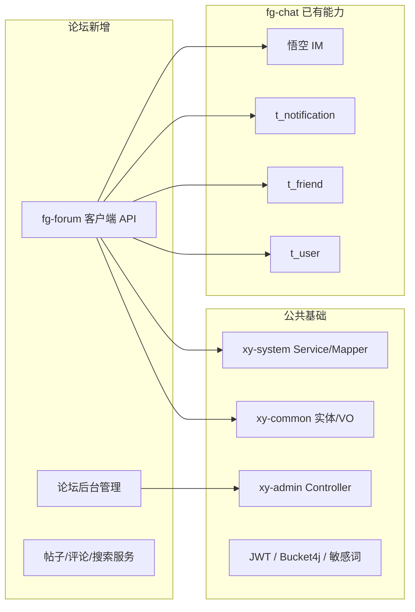
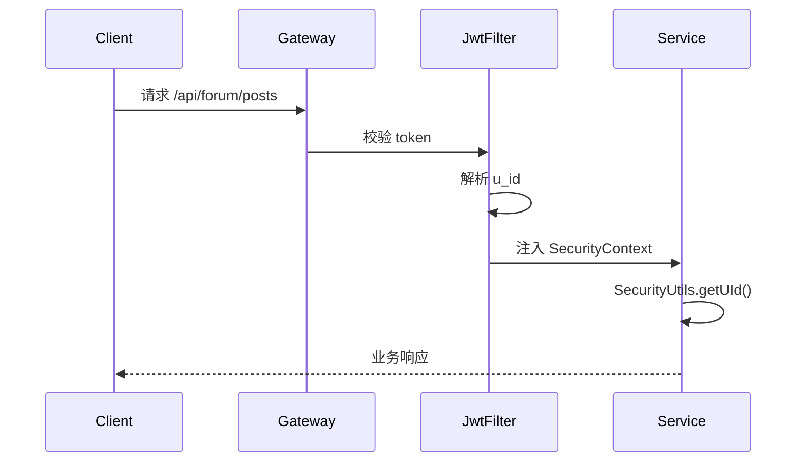
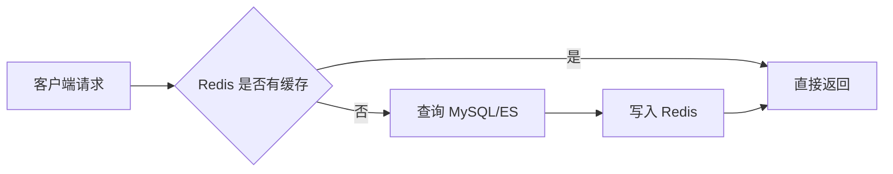

# 论坛系统技术方案计划书

| 项目 | 内容 |
|------|------|
| 文档版本 | v1.0 |
| 编制日期 | 2026-08-26 |
| 适用范围 | xy-service 项目 / fg-chat 扩展 |
| 编制人 | AI 技术助手 |

---

## 目录

1. [引言](#1-引言)
2. [系统架构与复用关系](#2-系统架构与复用关系)
3. [接口设计规范](#3-接口设计规范)
4. [安全策略](#4-安全策略)
5. [性能优化方案](#5-性能优化方案)
6. [开发计划](#6-开发计划)
7. [维护成本评估](#7-维护成本评估)
8. [扩展性评估](#8-扩展性评估)
9. [风险与应对措施](#9-风险与应对措施)
10. [附录](#10-附录)

---

## 1. 引言

### 1.1 编写目的

本计划书基于 `xy-service` 现有 `fg-chat` 模块，补充论坛系统剩余专项方案，包括接口规范、安全策略、性能优化、实施计划、维护成本与扩展性评估，为后续开发、测试、运维提供可落地的执行依据。

### 1.2 项目背景

`fg-chat` 已具备：

- 客户端用户体系 `t_user`
- 好友关系 `t_friend` / `t_friend_request`
- 通知体系 `t_notification`
- 悟空 IM 实时消息通道
- JWT + Spring Security 认证
- `xy-system` 数据层 / `xy-admin` 控制层分层模式

论坛系统在此基础上新增帖子、板块、评论、话题、搜索等能力，无需重建用户与 IM 体系。

### 1.3 术语表

| 术语 | 说明 |
|------|------|
| fg-chat | 现有即时通讯客户端服务模块 |
| fg-forum | 拟新增论坛客户端服务模块 |
| 悟空 IM | 第三方即时通讯中间件，提供实时消息推送 |
| ES | Elasticsearch，全文搜索引擎 |
| UGC | User Generated Content，用户生成内容 |

---

## 2. 系统架构与复用关系

### 2.1 模块复用图



### 2.2 数据复用清单

| 能力 | 现有表 / 服务 | 论坛使用方式 |
|------|--------------|-------------|
| 用户身份 | `t_user` | 作者、评论者、版主均使用 `u_id` |
| 好友关系 | `t_friend` | 支持“好友可见”帖子与内容分享 |
| 通知 | `t_notification` | 回复、点赞、@、审核结果统一落库 |
| 实时推送 | `WKClientService` | 通过悟空 IM 发送系统通知 |
| 认证 | `ChatUserDetailsService` | username 保持 `chat_{uId}` 格式 |
| 限流 | `Bucket4jConfig` | 发帖、评论、搜索等接口限流 |
| 敏感词 | `sensitive-word` | 标题/正文/评论前置过滤 |

---

## 3. 接口设计规范

### 3.1 通用约定

- **基础路径**：客户端 `/api/forum`，管理后台 `/admin/forum`
- **协议**：HTTPS
- **字符编码**：UTF-8
- **认证方式**：请求头 `token: {jwt}`，由 `JwtAuthenticationFilter` 统一校验
- **响应格式**：统一使用 `com.xy.common.core.domain.R<T>`
- **分页格式**：统一使用 `com.xy.common.core.domain.PageResult<T>`

#### 统一响应示例

```json
{
  "code": 200,
  "msg": "操作成功",
  "data": {}
}
```

#### 分页响应示例

```json
{
  "code": 200,
  "msg": "操作成功",
  "data": {
    "records": [],
    "total": 100,
    "current": 1,
    "size": 10
  }
}
```

### 3.2 HTTP 方法规范

| 操作 | 方法 | 示例 |
|------|------|------|
| 查询列表/详情 | GET | `GET /api/forum/posts/{postId}` |
| 创建资源 | POST | `POST /api/forum/posts` |
| 更新资源 | PUT | `PUT /api/forum/posts/{postId}` |
| 删除/下架 | DELETE | `DELETE /api/forum/posts/{postId}` |
| 状态切换 | POST | `POST /api/forum/posts/{postId}/like` |

### 3.3 状态码规范

| 状态码 | 含义 | 使用场景 |
|--------|------|----------|
| 200 | 成功 | 业务正常返回 |
| 400 | 请求参数错误 | 参数校验失败 |
| 401 | 未认证 | Token 缺失或过期 |
| 403 | 无权限 | 非版主/管理员越权操作 |
| 404 | 资源不存在 | 帖子/评论已删除 |
| 429 | 请求过于频繁 | 限流触发 |
| 500 | 服务器内部错误 | 系统异常 |

### 3.4 客户端接口清单

#### 3.4.1 板块相关

| 接口 | 方法 | 说明 |
|------|------|------|
| `/api/forum/boards` | GET | 查询板块树 |
| `/api/forum/boards/{boardId}` | GET | 板块详情 |
| `/api/forum/boards/{boardId}/posts` | GET | 板块下帖子列表 |
| `/api/forum/boards/{boardId}/follow` | POST | 关注/取消关注板块 |

#### 3.4.2 帖子相关

| 接口 | 方法 | 说明 |
|------|------|------|
| `/api/forum/posts` | POST | 发布帖子 |
| `/api/forum/posts/{postId}` | GET | 帖子详情 |
| `/api/forum/posts/{postId}` | PUT | 编辑帖子 |
| `/api/forum/posts/{postId}` | DELETE | 删除帖子 |
| `/api/forum/posts/{postId}/like` | POST | 点赞/取消点赞 |
| `/api/forum/posts/{postId}/favorite` | POST | 收藏/取消收藏 |
| `/api/forum/posts/{postId}/share` | POST | 分享统计 |
| `/api/forum/users/{uId}/posts` | GET | 用户发帖列表 |

#### 3.4.3 评论相关

| 接口 | 方法 | 说明 |
|------|------|------|
| `/api/forum/posts/{postId}/comments` | GET | 评论列表（含楼中楼） |
| `/api/forum/comments` | POST | 发表评论 |
| `/api/forum/comments/{commentId}` | DELETE | 删除评论 |
| `/api/forum/comments/{commentId}/like` | POST | 点赞/取消点赞评论 |

#### 3.4.4 话题与搜索

| 接口 | 方法 | 说明 |
|------|------|------|
| `/api/forum/topics` | GET | 热门话题 |
| `/api/forum/topics/{topicId}` | GET | 话题详情及帖子 |
| `/api/forum/topics/{topicId}/follow` | POST | 关注话题 |
| `/api/forum/search` | GET | 全文搜索 |
| `/api/forum/search/suggest` | GET | 搜索建议 |

#### 3.4.5 用户与通知

| 接口 | 方法 | 说明 |
|------|------|------|
| `/api/forum/users/{uId}/profile` | GET | 用户主页 |
| `/api/forum/users/{uId}/follow` | POST | 关注/取消关注用户 |
| `/api/forum/notifications` | GET | 通知列表（复用现有） |
| `/api/forum/notifications/{id}/read` | POST | 标记已读 |
| `/api/forum/favorites` | GET | 我的收藏 |

### 3.5 管理后台接口清单

| 接口 | 方法 | 说明 |
|------|------|------|
| `/admin/forum/boards` | POST/PUT/DELETE | 板块管理 |
| `/admin/forum/moderators` | POST/DELETE | 版主管理 |
| `/admin/forum/posts` | GET | 帖子审核列表 |
| `/admin/forum/posts/{id}/audit` | POST | 审核通过/拒绝 |
| `/admin/forum/posts/{id}/top` | POST | 置顶/取消置顶 |
| `/admin/forum/posts/{id}/essence` | POST | 加精/取消加精 |
| `/admin/forum/reports` | GET | 举报列表 |
| `/admin/forum/reports/{id}/handle` | POST | 处理举报 |
| `/admin/forum/configs` | GET/PUT | 论坛配置 |

### 3.6 接口字段规范

#### 发布帖子请求体

```json
{
  "boardId": 1,
  "title": "帖子标题",
  "content": "正文内容，支持 Markdown",
  "contentType": 1,
  "coverImage": "https://cdn.example.com/xxx.jpg",
  "visibility": 1,
  "topicNames": ["技术", "SpringBoot"]
}
```

#### 发表评论请求体

```json
{
  "postId": 10001,
  "parentId": 0,
  "rootId": 0,
  "replyToUid": null,
  "content": "评论内容，支持 @用户"
}
```

#### 搜索请求参数

```
GET /api/forum/search?q=SpringBoot&boardId=1&topicId=2&sort=hot&pageNum=1&pageSize=20
```

| 参数 | 说明 |
|------|------|
| q | 搜索关键词 |
| boardId | 板块筛选 |
| topicId | 话题筛选 |
| sort | 排序：new（最新）/ hot（热门）/ relevant（相关度） |
| pageNum | 页码 |
| pageSize | 页大小 |

---

## 4. 安全策略

### 4.1 认证与授权

#### 4.1.1 认证流程



#### 4.1.2 权限模型

| 角色 | 权限范围 |
|------|----------|
| 普通用户 | 发帖、评论、点赞、收藏、关注 |
| 版主 | 管理所属板块帖子：置顶、加精、删除违规内容 |
| 管理员 | 板块管理、版主任命、审核、举报处理、全局配置 |
| 系统账号 | 发送系统通知、官方公告 |

### 4.2 内容安全

#### 4.2.1 敏感词过滤

- 使用 `com.github.houbb:sensitive-word` 库。
- 在发帖、评论、私信转发论坛内容时前置校验。
- 命中敏感词时返回明确错误信息，并记录审计日志。

#### 4.2.2 AI 内容审核

- 调用 `xy-ai` 模块提供的审核接口。
- 审核维度：色情、暴力、政治敏感、广告、辱骂。
- 审核结果：
  - `PASS`：直接发布
  - `REVIEW`：进入人工审核队列
  - `REJECT`：拒绝发布并提示用户

#### 4.2.3 图片/视频审核

- 上传文件先进入七牛云私有空间。
- 通过七牛云内容审核服务或第三方接口扫描。
- 审核通过后才允许在帖子中展示。

### 4.3 接口安全

#### 4.3.1 限流策略

| 接口 | 限制 |
|------|------|
| 发帖 | 同一用户 5 分钟最多 3 篇 |
| 评论 | 同一用户 1 分钟最多 10 条 |
| 点赞 | 同一用户 1 分钟最多 50 次 |
| 搜索 | 同一 IP 1 分钟最多 30 次 |
| 举报 | 同一用户 1 天最多 20 次 |

使用 `Bucket4j` 实现，基于 Redis 分布式限流。

#### 4.3.2 防刷与反垃圾

- 新注册用户 24 小时内发帖需人工审核。
- 同一设备/IP 短时间内大量操作触发验证码或封禁。
- 高频点赞/关注行为纳入风控模型。

#### 4.3.3 输入校验

- 所有接口参数使用 `jakarta.validation` 校验。
- 标题长度 5-100 字符，正文最大 5 万字符。
- 评论最大 2000 字符。

### 4.4 数据安全

- **SQL 注入**：全部使用 MyBatis-Plus 参数化查询。
- **XSS**：前端渲染 Markdown 时使用可信库转义 HTML。
- **越权访问**：查询帖子/评论时强制校验 `author_id` 或权限角色。
- **隐私保护**：私密帖子、好友可见帖子在 SQL 层强制过滤。

### 4.5 审计与日志

- 关键操作记录：发帖、删帖、审核、举报处理、版主变更。
- 使用 `SysOperLog` 或新增 `t_forum_oper_log` 记录操作人、IP、时间、结果。
- 敏感词命中、审核拒绝记录单独日志表，便于复盘。

---

## 5. 性能优化方案

### 5.1 缓存架构



#### 缓存使用矩阵

| 缓存对象 | Redis 结构 | 过期时间 | 更新策略 |
|----------|-----------|----------|----------|
| 热帖列表 | ZSet | 10 分钟 | 定时刷新 + 写时失效 |
| 帖子详情 | Hash | 30 分钟 | 更新/删除时失效 |
| 用户基础信息 | Hash | 1 小时 | 更新时失效 |
| 点赞状态 | Set | 24 小时 | 实时写入 + 异步落库 |
| 评论第一页 | String/Hash | 10 分钟 | 新评论时失效 |
| 通知未读数 | String | 5 分钟 | 写入时递增 |
| 搜索热词 | Sorted Set | 1 小时 | 定时聚合 |
| 板块统计 | Hash | 15 分钟 | 定时刷新 |

### 5.2 数据库优化

#### 5.2.1 索引设计

- `t_forum_post`：`(board_id, status, is_top, published_time)`、`(author_id, status, published_time)`、`(status, published_time)`。
- `t_forum_comment`：`(post_id, root_id, status, create_time)`、`(parent_id)`、`(author_id)`。
- `t_forum_like`：`(target_type, target_id, status)`、`(u_id, target_type, target_id)`。
- `t_forum_follow`：`(u_id, follow_type, target_id)`、`(follow_type, target_id)`。

#### 5.2.2 分表策略

| 表 | 分表字段 | 策略 |
|----|---------|------|
| `t_forum_post` | `create_time` 或 `post_id % 128` | 水平分表，预留分表字段 `route_key` |
| `t_forum_comment` | `post_id % 128` | 按帖子 hash 分表 |
| `t_forum_like` | `target_id % 64` | 按目标 ID hash 分表 |

分表路由在 MyBatis-Plus 插件层统一处理，对业务代码透明。

#### 5.2.3 读写分离

- 读操作（列表、详情、搜索）优先走从库。
- 写操作（发帖、评论、点赞）走主库。
- 使用 Druid 或 ShardingSphere 配置读写分离数据源。

### 5.3 搜索优化

#### 5.3.1 Elasticsearch 索引设计

```json
{
  "mappings": {
    "properties": {
      "postId": { "type": "long" },
      "title": { "type": "text", "analyzer": "ik_max_word", "boost": 3.0 },
      "content": { "type": "text", "analyzer": "ik_max_word" },
      "boardId": { "type": "integer" },
      "topicIds": { "type": "integer" },
      "authorId": { "type": "long" },
      "status": { "type": "integer" },
      "publishedTime": { "type": "date" },
      "viewCount": { "type": "long" },
      "likeCount": { "type": "long" }
    }
  }
}
```

#### 5.3.2 同步策略

- 帖子发布/更新后，通过 Redis Stream 异步同步到 ES。
- 同步失败时写入死信队列，定时补偿。
- ES 与 MySQL 不一致时，以 MySQL 为准，ES 作为查询视图。

### 5.4 异步处理

#### 异步任务清单

| 任务 | 触发时机 | 处理方式 |
|------|----------|----------|
| 同步 ES | 发帖/更新/删除 | Redis Stream / RabbitMQ |
| 发送通知 | 点赞/评论/@ | 异步线程池 |
| 更新计数 | 点赞/评论/浏览 | Redis 累加 + 定时落库 |
| 内容审核 | 发帖/评论 | 异步调用 xy-ai |
| 积分/等级 | 互动行为 | 异步计算 |
| 清理缓存 | 数据变更 | 异步失效 |

### 5.5 静态资源与 CDN

- 图片、视频、附件统一上传七牛云 OSS。
- 前端静态资源打包后上传 CDN。
- 富文本内容中的图片使用 CDN 缩略图地址。

### 5.6 数据库连接池与 Tomcat 调优

- Druid 连接池：初始连接 20，最大连接 100，根据 QPS 调整。
- Tomcat 线程池：与 `fg-chat` 保持一致，最大 800，最小空闲 100。
- 启用 MySQL 连接池预编译缓存。

---

## 6. 开发计划

### 6.1 项目组织

| 模块 | 包路径 | 说明 |
|------|--------|------|
| 实体/DTO/VO | `com.xy.common.entity.forum.*` | 新增到 `xy-common` |
| Mapper | `com.xy.system.mapper.forum.*` | 新增到 `xy-system` |
| Service | `com.xy.system.service.forum.*` | 新增到 `xy-system` |
| 后台 Controller | `com.xy.admin.controller.forum.*` | 新增到 `xy-admin` |
| 客户端 API | `com.chat.fg.forum.*` | 新增模块 `customer-api/fg-forum` |
| SQL | `sql/forum.sql` | 建表脚本 |

### 6.2 工作分解结构（WBS）

```mermaid
flowchart TD
    A[论坛系统] --> B[基础设施]
    A --> C[核心功能]
    A --> D[搜索与推荐]
    A --> E[安全与审核]
    A --> F[性能优化]
    A --> G[测试与上线]

    B --> B1[创建 fg-forum 模块]
    B --> B2[数据库设计与脚本]
    B --> B3[实体/VO/DTO 定义]
    B --> B4[对接 fg-chat 认证]

    C --> C1[板块管理]
    C --> C2[帖子发布/编辑/删除]
    C --> C3[评论与楼中楼]
    C --> C4[点赞/收藏/关注]
    C --> C5[话题解析与聚合]
    C --> C6[用户主页与通知]

    D --> D1[Elasticsearch 集成]
    D --> D2[全文搜索接口]
    D --> D3[热门/推荐流]

    E --> E1[敏感词过滤]
    E --> E2[AI 内容审核]
    E --> E3[举报与后台审核]
    E --> E4[限流与风控]

    F --> F1[Redis 缓存]
    F --> F2[异步消息]
    F --> F3[读写分离/分表]

    G --> G1[单元/接口测试]
    G --> G2[性能压测]
    G --> G3[部署上线]
```



### 6.3 里程碑计划

| 阶段 | 周期 | 关键交付物 | 验收标准 |
|------|------|-----------|----------|
| 阶段一：基础搭建 | 第 1-3 周 | 模块创建、数据库脚本、认证对接完成 | 可正常启动，接口可通过 JWT 访问 |
| 阶段二：核心功能 | 第 4-8 周 | 板块、帖子、评论、点赞、收藏、话题、通知 | 完整发帖-评论-通知流程跑通 |
| 阶段三：搜索与推荐 | 第 9-11 周 | ES 集成、搜索接口、热门流、关注流 | 搜索响应 < 200ms，推荐流稳定 |
| 阶段四：安全与审核 | 第 12-13 周 | 敏感词、AI 审核、举报后台、限流 | 违规内容拦截率 > 95% |
| 阶段五：性能优化与上线 | 第 14-15 周 | 缓存、异步、压测、部署 | 单接口 QPS 达标，系统稳定运行 |

### 6.4 人力资源估算

| 角色 | 人数 | 投入周期 |
|------|------|----------|
| 后端开发 | 2 人 | 全程 |
| 前端开发 | 2 人 | 第 2 周起 |
| 产品经理 | 0.5 人 | 全程 |
| 测试工程师 | 1 人 | 第 8 周起 |
| 运维工程师 | 0.5 人 | 第 12 周起 |

---

## 7. 维护成本评估

### 7.1 基础设施成本（月度估算）

| 资源 | 规格 | 数量 | 估算费用 |
|------|------|------|----------|
| 应用服务器 | 4C8G | 2 | 按云厂商计费 |
| MySQL | 8.0 主从 | 1 组 | 按云厂商计费 |
| Redis | 集群 4G | 1 组 | 按云厂商计费 |
| Elasticsearch | 3 节点 | 1 组 | 按云厂商计费 |
| 七牛云 OSS | 按流量/存储 | - | 按使用量 |
| 悟空 IM | 按 MAU | - | 按用户数 |
| AI 审核 | 按调用量 | - | 按调用量 |

### 7.2 人力维护成本

| 维护项 | 频率 | 人力投入 |
|--------|------|----------|
| 敏感词库更新 | 每周 | 1 人/小时 |
| 内容审核复核 | 每日 | 1 人/小时 |
| 举报处理 | 每日 | 1 人/小时 |
| 系统监控与告警 | 每日 | 0.5 人/小时 |
| 数据备份 | 每日自动 | 0.2 人/小时 |
| 版本迭代 | 每两周一次 | 2 人/周 |

### 7.3 维护成本结论

- **日常运维**：中等。论坛为 UGC 系统，内容审核与举报处理是持续人力投入点。
- **技术债务**：较低。复用现有用户/通知/IM 体系，模块边界清晰，便于长期维护。
- **总成本**：初期以开发投入为主，上线后以内容运营和服务器资源为主。

---

## 8. 扩展性评估

### 8.1 横向扩展能力

| 扩展方向 | 方案 |
|----------|------|
| 用户规模 | 应用无状态化 + 负载均衡；数据库读写分离 + 分库分表 |
| 内容规模 | 帖子/评论/点赞按规则分表；ES 扩容节点 |
| 流量峰值 | Redis 缓存 + CDN + 限流降级 + 异步削峰 |
| 功能扩展 | 新增模块即可，不影响现有 fg-chat |
| 多社区 | 板块表增加 `community_id` 字段，数据天然隔离 |
| 国际化 | 内容表增加 `lang` 字段，ES 配置多语言分词 |

### 8.2 未来可演进方向

- **推荐系统**：引入独立推荐服务，基于用户浏览/点赞/关注行为做个性化推荐。
- **问答模块**：在帖子表增加 `post_type`，支持问答帖，答案可采纳。
- **活动/投票帖**：通过 `extra_data` JSON 字段扩展投票、报名等能力。
- **商业化**：积分商城、打赏、付费精华帖。
- **AI 助手**：接入 `xy-ai` 作为论坛智能客服/内容生成助手。

### 8.3 扩展性结论

- 架构设计预留了分表字段、社区字段、扩展字段，可支撑百万级用户与千万级内容。
- 搜索与推荐可独立演进，不阻塞核心业务。
- 与 fg-chat 解耦得当，两边可独立迭代。

---

## 9. 风险与应对措施

| 风险 | 影响 | 概率 | 应对措施 |
|------|------|------|----------|
| ES 与 MySQL 数据不一致 | 高 | 中 | 异步同步 + 死信队列 + 定时校验补偿 |
| 违规内容漏审 | 高 | 中 | 敏感词 + AI 审核 + 人工复核 + 用户举报 |
| 热帖流量突增 | 高 | 中 | Redis 缓存 + CDN + 限流 + 降级策略 |
| IM 推送失败 | 中 | 低 | 通知必须落库，IM 仅作为实时增强 |
| 分表后跨页查询复杂 | 中 | 中 | 采用全局 ID + 路由键，避免跨分片聚合 |
| 前端与后端接口不同步 | 中 | 中 | 使用 Swagger/OpenAPI 文档，前后端并行开发 |
| 第三方服务依赖（七牛云/悟空 IM） | 中 | 低 | 设计降级方案，关键路径避免强依赖 |

---

## 10. 附录

### 10.1 新增表清单

- `t_forum_board`
- `t_forum_post`
- `t_forum_comment`
- `t_forum_like`
- `t_forum_favorite`
- `t_forum_topic`
- `t_forum_post_topic`
- `t_forum_follow`
- `t_forum_moderator`
- `t_forum_report`
- `t_forum_user_profile`（可选）
- `t_forum_oper_log`（可选）

### 10.2 复用表清单

- `t_user`
- `t_friend`
- `t_friend_request`
- `t_notification`

### 10.3 关键技术依赖

- Spring Boot 3.2.4
- MyBatis-Plus 3.5.5
- MySQL 8.0+
- Redis
- Elasticsearch 7/8
- 七牛云 OSS
- 悟空 IM
- Bucket4j
- sensitive-word
- JWT

### 10.4 参考文档

- [sql/chat.sql](../sql/chat.sql)
- [customer-api/fg-chat](../customer-api/fg-chat)
- [xy-system](../xy-system)
- [xy-admin](../xy-admin)
- [xy-common](../xy-common)

---

**文档结束**
