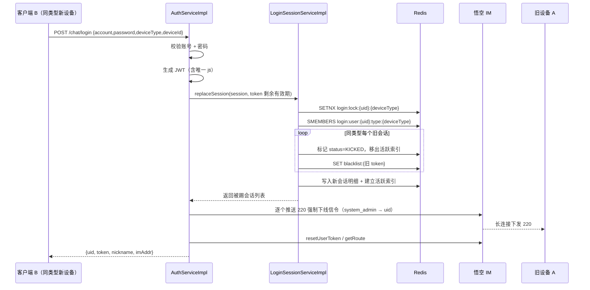

# 多端登录管控功能设计文档

> 目标：同一账号在 **PC 端 / 平板端 / 手机端** 三个设备类型分组之间可同时在线；
> 同一设备类型下 **只允许保留 1 个有效会话**，新登录强制踢掉同类型旧会话并推送强制下线通知。

---

## 1. 需求与实现映射

| # | 需求 | 实现要点 |
|---|------|----------|
| 1 | 设备分类三维度（PC / 平板 / 手机）互不冲突 | `DeviceType` 枚举（1/2/3），会话索引按 `uid + deviceType` 分组 |
| 2 | 同类型最多 1 个有效会话，新登录踢掉同类型旧会话 | `LoginSessionServiceImpl#replaceSession`（分布式锁 + 同类型全量失效） |
| 3 | 规范会话存储结构 | `LoginSession`（uid/deviceType/deviceId/deviceName/token/loginTime/lastActiveTime/status/ip）存于 Redis |
| 4 | 完整登录流程（校验 → 查旧会话 → 标记失效 → 写新会话 → 长连接推送） | `AuthServiceImpl#login` + `ForceLogoutNotifier` |
| 5 | 客户端弹窗提示 + 清除登录态 + 跳登录页 | `ForceLogoutDialog` + `store/user.ts#outLogin` |
| 6 | 离线旧设备携带旧 token 请求返回指定失效码 | `JwtAuthenticationFilter` 命中黑名单直接返回 HTTP 401 + `4011` |
| 7 | 会话增删改严格身份校验防越权 | 登出接口仅允许操作 `SecurityUtils.getUId()` 自身会话；无对外会话 CRUD 接口 |
| 8 | 全场景测试 | `scripts/multi-device-login-test.sh` + `test-report.md` |
| 9 | 交付物 | 本设计文档 / 后端实现 / 各端适配 / 测试报告 |

---

## 2. 总体架构

```
        ┌──────────────┐  ① 登录（携带 deviceType/deviceId）
        │  客户端 A     │ ─────────────────────────────┐
        │ （同类型旧设备）│                              ▼
        └──────────────┘                    ┌──────────────────────┐
                ▲  ⑤ IM 长连接推送 220 信令  │  fg-chat 登录入口     │
                └───────────────────────────│  AuthServiceImpl      │
                                            └───────┬──────────────┘
        ┌──────────────┐  ① 登录                     │ ② 同类型旧会话失效
        │  客户端 B     │ ────────────────────────────┤ ③ 写新会话
        │ （同类型新设备）│                              ▼
        └──────────────┘                    ┌──────────────────────┐
                │ ④ 后续请求携带新 token     │  Redis 会话存储       │
                ▼                            │  login:session:*      │
        ┌──────────────────────┐             │  login:user:*:type:*  │
        │ JwtAuthenticationFilter│──黑名单──▶│  blacklist:*          │
        └──────────────────────┘             └──────────────────────┘
```

---

## 3. 设备分类维度

[DeviceType.java](file:///Users/xiaoyi/me-project/xy-service-out/customer-api/fg-chat/src/main/java/com/chat/fg/enums/DeviceType.java)

| code | 分组 | 说明 |
|------|------|------|
| 1 | PC 端 | 桌面客户端（Tauri）与桌面浏览器 |
| 2 | 平板端 | iPad / Android Tablet |
| 3 | 手机端 | iPhone / Android 手机 |

- 客户端登录时上报 `deviceType`；未上报时后端按 `User-Agent` 兜底推断（`resolveByUserAgent`）。
- 前端 `detectDeviceType()` 优先识别 Tauri（PC），其次按 UA / `maxTouchPoints` 判断平板（iPad Safari 的 UA 与 Mac 相同，需依赖触摸点数区分）。
- 三个分组 **完全隔离**：互踢只在同分组内发生。

---

## 4. 会话存储结构

[LoginSession.java](file:///Users/xiaoyi/me-project/xy-service-out/customer-api/fg-chat/src/main/java/com/chat/fg/pojo/LoginSession.java)

| 字段 | 类型 | 说明 |
|------|------|------|
| `uid` | Long | 用户 ID |
| `deviceType` | Integer | 设备类型分组 1/2/3 |
| `deviceId` | String | 设备唯一标识（客户端本地持久化） |
| `deviceName` | String | 设备描述（设备类型 + UA 简写） |
| `token` | String | 会话 Token（JWT，含唯一 `jti`） |
| `loginTime` | Long | 登录时间（epoch millis） |
| `lastActiveTime` | Long | 最后活跃时间（节流刷新） |
| `status` | String | `ACTIVE` / `KICKED` / `LOGOUT`（[SessionStatus](file:///Users/xiaoyi/me-project/xy-service-out/customer-api/fg-chat/src/main/java/com/chat/fg/enums/SessionStatus.java)） |
| `ip` | String | 登录 IP |

### Redis Key 设计

| Key | 结构 | 内容 | TTL |
|-----|------|------|-----|
| `login:session:{token}` | String(JSON) | 会话明细 | token 剩余有效期 |
| `login:user:{uid}` | Set | 该用户全部会话 token | token 剩余有效期 |
| `login:user:{uid}:type:{deviceType}` | Set | 该用户某设备类型的会话 token（**活跃索引**） | token 剩余有效期 |
| `login:lock:{uid}:{deviceType}` | String | 互踢操作分布式锁 | 10s（lease） |
| `blacklist:{token}` | String | 已失效 token 黑名单（复用 `TokenBlacklistService`） | token 剩余有效期 |

设计说明：

- **TTL 与 token 剩余有效期对齐**：避免 JWT 过期后 Redis 仍残留会话记录。
- **失效会话保留记录**：被顶下线 / 登出时把 `status` 置为 `KICKED` / `LOGOUT` 并保留至 token 过期，便于追溯，但会 **从活跃索引中移除**（`touch` 不会把失效会话重新写回索引）。
- 活跃索引按类型拆分，使同类型互踢只扫描该类型分组，避免跨类型误伤。

---

## 5. 登录流程

[AuthServiceImpl#login](file:///Users/xiaoyi/me-project/xy-service-out/customer-api/fg-chat/src/main/java/com/chat/fg/service/impl/AuthServiceImpl.java)



关键点：

1. **推送时机在 `resetUserToken` 之前**：悟空 IM 的 `deviceLevel=0` 会抢占同等级设备连接，若先重置 IM token，旧设备可能已断开而收不到通知。
2. **分布式锁**：同一用户同一设备类型的并发登录串行化，避免并发下出现 2 个活跃会话。
3. **jti 唯一**：同一用户同一秒内重复登录时，JWT 内容若无 `jti` 将完全一致，会导致「按 token 精确踢下线」误伤新会话（[JwtTokenProvider](file:///Users/xiaoyi/me-project/xy-service-out/xy-common/src/main/java/com/xy/common/provider/JwtTokenProvider.java)）。

---

## 6. 强制下线通知协议

[ForceLogoutNotifier.java](file:///Users/xiaoyi/me-project/xy-service-out/customer-api/fg-chat/src/main/java/com/chat/fg/service/ForceLogoutNotifier.java)

- 复用悟空 IM 个人频道：`from_uid=system_admin`、`channel_id={被踢用户 uid}`、`channel_type=1`。
- `header`：`no_persist=1`（不持久化）、`red_dot=0`、`sync_once=0`。

```json
{
  "type": 220,
  "content": "{\"uid\":10086,\"deviceType\":3,\"deviceName\":\"手机端 / Mozilla/5.0 ...\",\"kickedToken\":\"eyJhbGci...\",\"reason\":\"您的账号已在其他同类型设备上登录，当前设备已被强制退出\"}"
}
```

| 字段 | 说明 |
|------|------|
| `type` | `MessageType.forceLogout = 220`（[MessageType.java](file:///Users/xiaoyi/me-project/xy-service-out/xy-common/src/main/java/com/xy/common/enums/MessageType.java)） |
| `uid` | 被踢用户 ID |
| `deviceType` | 被踢设备类型 |
| `deviceName` | 被踢设备描述 |
| `kickedToken` | 被踢会话 token（客户端比对本地 token，防止误踢新设备） |
| `reason` | 直接用于弹窗展示的文案 |

推送失败仅记录 error 日志、不阻断登录主流程：离线设备由 token 黑名单兜底。

---

## 7. 失效会话访问拦截

[JwtAuthenticationFilter.java](file:///Users/xiaoyi/me-project/xy-service-out/xy-framework/src/main/java/com/xy/framework/security/filter/JwtAuthenticationFilter.java)

```
请求携带 token
  └─ token 命中黑名单（被顶下线 / 已登出）
       └─ 立即返回 HTTP 401 + {"code":4011,"msg":"登录状态已失效，请重新登录"}，终止链路
  └─ token 无效 / 已过期
       └─ 不设置认证信息 → AuthenticationEntryPoint 返回 HTTP 401 + {"code":401,"msg":"登录已过期"}
```

- 原实现使用 `finally { filterChain.doFilter(...) }`，导致黑名单校验形同虚设（即使命中黑名单，请求仍会继续传递到控制器）；现改为命中黑名单 **直接 return**。
- `ResultCode.SESSION_EXPIRED(4011)`（[ResultCode.java](file:///Users/xiaoyi/me-project/xy-service-out/xy-common/src/main/java/com/xy/common/enums/ResultCode.java)）为需求 6 要求的「登录态失效指定错误码」。

---

## 8. 越权防护

- **登出接口**（`POST /auth/logout`，需认证）：只接受当前请求头携带的 token，且校验 `session.uid == SecurityUtils.getUId()`，不一致直接拒绝，防止用他人 token 结束他人会话。
- **不对外暴露会话 CRUD 接口**：会话的新增（登录）/ 删除（登出/顶下线）/ 更新（活跃时间）全部由服务端内部触发，客户端无法指定目标 uid 或 token。
- **失效 token 立即拉黑**：`endSession` 同时写入黑名单，防止「标记状态」与「拦截请求」之间存在时间窗。

---

## 9. 各端客户端适配

### 9.1 设备信息采集

[device.ts](file:///Users/xiaoyi/me-project/xy-service-out/y-micro-app/apps/y-chat-sub/src/utils/device.ts)

- `getDeviceId()`：`localStorage` 持久化随机 UUID，首次生成后不变。
- `detectDeviceType()`：Tauri → PC；UA 含 ipad/tablet/pad → 平板；iPad Safari（macintosh + maxTouchPoints>1）→ 平板；含 mobile/android/iphone → 手机；其余 → PC。
- 登录参数注入位置：[store/user.ts](file:///Users/xiaoyi/me-project/xy-service-out/y-micro-app/apps/y-chat-sub/src/store/user.ts) `userLogin` 中统一合并 `getDeviceInfo()`，网页端与桌面端共用同一套登录页逻辑，无需分别改造。

### 9.2 消息分流

- [constants.ts](file:///Users/xiaoyi/me-project/xy-service-out/y-micro-app/apps/y-chat-sub/src/services/im/constants.ts)：新增 `FORCE_LOGOUT = 220`。
- [message-handler.ts](file:///Users/xiaoyi/me-project/xy-service-out/y-micro-app/apps/y-chat-sub/src/services/im/message-handler.ts)：在 `RTC_RECORD` 之后、`isSystemMessageType(>=100)` 之前拦截 `220`，避免被当作普通系统通知；新增 `onForceLogout / offForceLogout` 订阅。

### 9.3 强制下线弹窗与登录态清理

[ForceLogoutDialog/index.vue](file:///Users/xiaoyi/me-project/xy-service-out/y-micro-app/apps/y-chat-sub/src/components/ForceLogoutDialog/index.vue)（挂载于 [layout/index.vue](file:///Users/xiaoyi/me-project/xy-service-out/y-micro-app/apps/y-chat-sub/src/layout/index.vue)，全局常驻）

1. 收到 220 信令 → 解析 `content`；
2. 校验 `kickedToken === getToken()`，不一致则忽略（本机已是新登录设备）；
3. 弹窗展示 `reason`；
4. 调用 `userStore.outLogin()` 清除 token、用户信息、聊天数据、IM 连接（桌面端由 Rust 切回登录小窗口）；
5. 点击「重新登录」→ `router.push('/login')`。

### 9.4 HTTP 层失效兜底

[request.ts](file:///Users/xiaoyi/me-project/xy-service-out/y-micro-app/apps/y-chat-sub/src/utils/request.ts)

- 业务码 `401` / `4011`，或 HTTP 401 → 派发全局 `session-expired` 事件；
- `ForceLogoutDialog` 监听该事件，走同一套「弹窗 + 清态 + 跳登录」流程；
- 请求层不直接依赖 store / router，避免循环引用。

### 9.5 主动登出

[Header/index.vue](file:///Users/xiaoyi/me-project/xy-service-out/y-micro-app/apps/y-chat-sub/src/layout/Header/index.vue)：先调用 `POST /auth/logout` 让服务端将会话置为 `LOGOUT` 并拉黑 token，再清理本地状态并跳转登录页（服务端调用失败不阻断本地退出）。

---

## 10. 涉及文件清单

### 后端

| 模块 | 文件 | 变更 |
|------|------|------|
| xy-common | `enums/MessageType.java` | 新增 `forceLogout(220)` |
| xy-common | `enums/ResultCode.java` | 新增 `SESSION_EXPIRED(4011)` |
| xy-common | `provider/JwtTokenProvider.java` | 新增唯一 `jti`、`getJtiFromToken` |
| fg-chat | `enums/DeviceType.java` | 新增 |
| fg-chat | `enums/SessionStatus.java` | 新增 |
| fg-chat | `pojo/LoginSession.java` | 新增 |
| fg-chat | `service/ILoginSessionService.java` | 新增 |
| fg-chat | `service/impl/LoginSessionServiceImpl.java` | 新增 |
| fg-chat | `service/ForceLogoutNotifier.java` | 新增 |
| fg-chat | `security/SessionTouchFilter.java` | 新增（刷新最后活跃时间，5 分钟节流） |
| fg-chat | `pojo/dto/LoginDTO.java` | 新增 `deviceType` / `deviceId` |
| fg-chat | `service/impl/AuthServiceImpl.java` | 登录接入互踢与推送；新增 `logout` |
| fg-chat | `controller/AuthController.java` | 登录透传 IP/UA；新增 `POST /auth/logout` |
| xy-framework | `security/filter/JwtAuthenticationFilter.java` | 黑名单直接返回 401 + 4011 |

### 前端（y-chat-sub）

| 文件 | 变更 |
|------|------|
| `services/im/constants.ts` | 新增 `FORCE_LOGOUT = 220` |
| `services/im/message-handler.ts` | 220 前置分流 + 订阅接口 |
| `utils/device.ts` | 新增（设备 ID / 设备类型） |
| `utils/request.ts` | 401 / 4011 派发全局失效事件 |
| `components/ForceLogoutDialog/index.vue` | 新增（强制下线弹窗） |
| `layout/index.vue` | 挂载弹窗 |
| `layout/Header/index.vue` | 登出调用服务端接口 |
| `store/user.ts` | 登录上报设备信息 |
| `api/auth.ts` | 新增 `logout` |

---

## 11. 边界与已知限制

| 场景 | 处理 |
|------|------|
| 旧设备离线 | 收不到 220 信令；token 已拉黑，后续任何请求返回 401 + 4011，前端引导重新登录 |
| 用户名下 token 自然过期 | Redis 会话随 TTL 失效，索引读取时惰性清理残留成员 |
| 跨类型多端在线 | 支持：PC / 平板 / 手机各保留 1 个活跃会话 |
| Redis 不可用 | 登录时 `replaceSession` 抛异常，登录失败（不降级为无管控），避免出现「同类型多会话同时在线」 |
| IM 推送失败 | 仅告警，不阻断登录；由黑名单兜底 |
| 客户端未上报 deviceType | 后端按 UA 兜底推断，行为等价于前端上报 |

> 说明：悟空 IM 侧 `resetUserToken(deviceFlag=1, deviceLevel=0)` 为既有逻辑，本次未改动；同类型互踢以服务端会话为准。